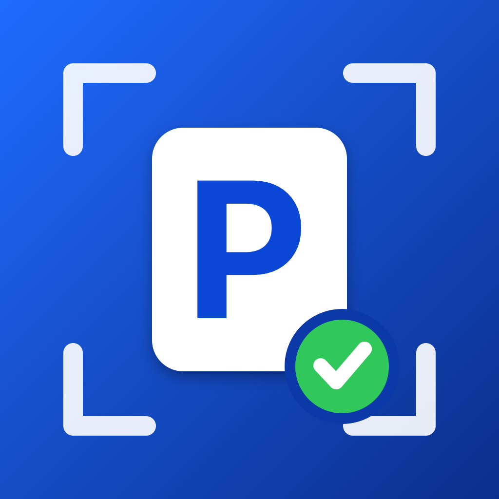
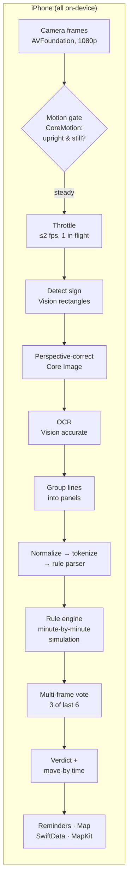

<p align="center">
  
</p>

<h1 align="center">CurbLens</h1>

<p align="center"><b>Point your iPhone at a Boston parking sign. Get a plain answer: <i>can I park here right now, and when do I have to move?</i></b></p>

<p align="center">
  <a href="https://github.com/darshanpatil2511/ACADEMIC-PROJECTS-AND-RESEARCH-PAPER/actions/workflows/curblens-ci.yml"></a>
  
  
  
  
</p>

---

Boston parking signs pack several rules onto one pole: a 2-hour limit, street cleaning on the
2nd and 4th Tuesday from April to November, a tow zone, a resident-permit exemption. Misreading one
means a ticket or a tow. CurbLens reads the whole pole through the camera, turns the text into
structured rules, simulates them against the current time, and answers in one line. It can also remind
you before you have to move.

Everything runs **on the phone**: no server, no account, no network call, no paid API.

> **Demo:** *20-second screen recording goes here (`docs/demo.gif`).*

## Highlights

| | |
|---|---|
| ⚡ **~0.1 s per sign on-device** | 103 ms p50 / 139 ms p95 for the full pipeline on an iPhone 17 Pro (Neural Engine), measured with an in-app benchmark |
| 🎯 **Verdict accuracy** | 78% of time-specific verdicts correct on 26 hand-labeled real-world signs (dev split); 6/6 on a small held-out split |
| 📈 **Measured, eval-driven parser work** | One round of fixes driven by failure reports: held-out rule exact-match **20% → 40%**, rule-type accuracy **43% → 86%**; Boston street photos **0% → 33%** exact match |
| 🛡️ **Fails safe** | 0 rules invented on 10 out-of-scope signs (private lots, pay-by-app, temporary notices): the app says "couldn't read" instead of guessing |
| 🧪 **Tested core** | 93 automated tests (Swift Testing), 64 parser fixtures from real OCR output, GitHub Actions CI |
| 🔒 **Private by design** | Apple frameworks only, zero network code, data stored on-device with SwiftData |

## What it does

- **Live scanner.** Point the camera at a sign. Frames are read only while the phone is steady, and a
  verdict appears once 3 of the last 6 frames agree. Pinch to zoom, or switch to the telephoto lens for
  signs high on a pole. **Capture** runs a full-resolution, high-accuracy read.
- **Plain-English verdict.** *"You can park · Move by tomorrow at 9:00 AM"*, or *"No parking now · Allowed
  from 12:00 PM · Street cleaning"*. Includes a tow-zone badge, notes for permit and snow-emergency rules,
  and a "double-check the sign" warning when some text wasn't understood.
- **I parked here.** Saves the spot and schedules local notifications 30 and 10 minutes before the
  move-by time, and at it. The home screen shows the active session with *Find car* and *I've left*.
- **Saved signs.** Each saved sign stores its rules, location, compass heading and camera tilt. A map shows
  them with pins colored by whether you can park there *right now*.
- **Photo import** of existing photos, and an **on-device benchmark** screen that reports latency per stage.

## How it works



The interesting logic lives in **CurbCore**, a Swift package with no UI dependencies. The app, the unit
tests and the evaluation CLI all share it, and it builds and tests on a Mac without a phone.

1. **Detect and straighten.** `VNDetectRectanglesRequest` finds the sign, and `CIPerspectiveCorrection`
   flattens it. If the crop looks partial (Boston poles carry several signs), the whole frame is read too,
   and the reading that understands more wins.
2. **Read.** `VNRecognizeTextRequest`, with language correction biased toward the sign vocabulary.
3. **Normalize.** OCR text is messy (`N0 PARK1NG 8AM-l2 NOON`, `Bam - 12noor`, `Novomber`). The normalizer
   fixes digit/letter confusions only inside number-like tokens, corrects long sign words one edit away,
   unifies ranges (`TO`, `THRU`, `–`), and logs every change.
4. **Parse.** A rule-based parser finds the phrases that decide a rule's type (`NO PARKING`,
   `2 HOUR PARKING`, `STREET CLEANING`, `VALET PARKING ONLY`, …), cuts the text into one segment per rule,
   and attaches time windows, days (`MON-FRI`, `EXCEPT SUN`, `2ND & 4TH TUE`), seasons, `TOW ZONE`,
   resident exemptions and permit districts. Words it can't use are reported, never silently dropped.
5. **Decide.** The rule engine steps forward minute by minute for up to 8 days (≈11,500 steps, which is
   instant). The first minute a prohibition becomes active, or a time-limit counter fills, is the move-by
   time. Overnight windows and limits that pause overnight need no special cases. For example, a 2-hour
   limit (8 AM–8 PM) entered at 7 PM runs out at 9 AM the next day.

## Results

All numbers come from `curbeval`, a command-line evaluation tool in this repo, over photos labeled by hand:
transcript, rules, and 1–4 timed verdict checks per photo.

### Accuracy (latest run)

| Split | Photos | Verdict accuracy | Rule exact match | Rule type | Sign found |
|---|---|---|---|---|---|
| Dev: real-world web photos | 26 | **78%** (36/46 checks) | 58% | 62% | 96% |
| Held-out test (never tuned on) | 5 | **100%** (6/6 checks) | 40% | 86% | 100% |
| Fixture photos (committed labels) | 5 | 85% (11/13 checks) | 40% | 78% | 80% |

*Verdict accuracy* asks whether the app gives the right answer (can park / can't park / couldn't read) at
specific times. *Exact match* requires every rule on the pole to be perfect, which is much stricter.

### One eval-driven iteration

I ran the eval, read the failure report, and fixed the five most common failure patterns test-first.
Each fix was checked on the dev split only. The held-out split was scored once, before and after:

| Metric | Before | After |
|---|---|---|
| Held-out rule exact match | 20% | **40%** |
| Held-out rule-type accuracy | 43% | **86%** |
| Dev rule exact match | 42% | **58%** |
| Dev exact match, Boston street photos | 0% | **33%** |
| Out-of-scope signs correctly left unread | 90% | **100%** |

The fixes:
- recognizing Boston permit districts as zones (even when OCR glues the header onto another line)
- reading a stacked big digit ("PARKING LIMIT **2**")
- treating `VALET PARKING ONLY` as its own rule
- OCR typo repair
- detecting posted temporary notices by their numeric dates

### Ablation (dev split, 26 photos)

| Configuration | Verdict | Exact match | Rule type | Time window | OCR char. error | p50 ms (Mac CPU) |
|---|---|---|---|---|---|---|
| **Baseline**: accurate OCR + crop + language correction | **78%** | **58%** | 62% | 52% | **0.353** | 108 |
| No sign crop | 78% | 58% | 62% | 52% | 0.376 | 58 |
| No language correction | 78% | 58% | 62% | 52% | 0.384 | 73 |
| Fast OCR | 59% | 42% | 24% | 21% | 0.410 | 32 |

**What it showed:**
- **Accurate OCR matters most.** Fast mode loses most time windows ("7AM-7PM" gets read as "any time"),
  which is why the live scanner also uses accurate OCR, at 2 fps instead of fast OCR at 3 fps.
- **Language correction** lowers the character error rate without changing the rules at this dataset size.
- **Cropping** doesn't pay for its ~50 ms yet, and is worth revisiting with more angled photos.

### On-device latency (iPhone 17 Pro, iOS 27, Neural Engine)

| Stage | p50 | p95 |
|---|---|---|
| Detect + correct | ≈8 ms | ≈9 ms |
| OCR | 91 ms | 126 ms |
| Group + parse | ≈2 ms | ≈5 ms |
| **Total** | **103 ms** | **139 ms** |

The first, cold read takes 143 ms. Measured with the in-app benchmark (5 photos × 3 runs). Combined rows add up per-stage percentiles, so they're approximate.

Full reports, including every failure with expected vs. got, are in [`Reports/`](Reports/).

## Engineering decisions

| Decision | Why |
|---|---|
| **Rule-based parser, not ML** | Sign language is a small, fixed vocabulary. A parser is deterministic, unit-testable and explainable, needs no training data, and reports exactly which words it didn't understand. An ML model would make sense for free-form or handwritten signs. |
| **Minute-by-minute simulation** | One simple loop handles time limits that pause overnight, overnight windows, nth-weekday rules and seasons with no special cases. Easy to reason about and to test. |
| **Fail safe over fail silent** | A wrong "you can park" costs a tow. Temporary notices, private-lot signs and unreadable hours give "couldn't read", not a guess. Read errors always count as failures in the eval. |
| **Sensor-gated frames + multi-frame voting** | CoreMotion gravity and rotation rate skip blurry frames. Requiring 3 of 6 frames to agree filters OCR flicker before a verdict is shown. |
| **Shared Swift package (CurbCore)** | The same code runs in the app, the tests and the eval CLI. It has no UIKit or SwiftUI, takes `CGImage` at the boundaries, and every date calculation takes an injected `Calendar`, so tests pin exact Boston times. |
| **Dev / held-out split** | Fixes are tuned only on dev failures. The held-out score is the honest number. |
| **XcodeGen** | The Xcode project is generated from a readable `project.yml` and never hand-edited. |

## Project structure

```
Curb Lens/
├── App/                     iOS app (SwiftUI, iOS 17)
│   ├── Camera/              AVFoundation capture, multi-lens zoom, live scanner model
│   ├── Motion/              CoreMotion steadiness gate and camera tilt
│   ├── Location/            One-shot GPS + compass heading
│   ├── Parking/             Sessions, local-notification reminders
│   ├── Storage/             SwiftData models (saved signs, parking sessions)
│   └── Views/               Welcome, scanner, result, saved signs + map, benchmark
├── CurbCore/                Swift package (iOS 17 + macOS 14)
│   ├── Sources/CurbCore/
│   │   ├── Model/           ParkingRule, DayRule, TimeWindow, Verdict…
│   │   ├── Engine/          Rule engine, verdict text
│   │   ├── Parse/           Normalizer, tokenizer, sign parser
│   │   ├── Vision/          SignReader: detect → correct → OCR → panels
│   │   ├── Live/            Steadiness rule, frame voter, throttle
│   │   ├── Parking/         Reminder planning, compass/distance text
│   │   └── Eval/            Labels, metrics, scoring, reports
│   ├── Sources/curbeval/    CLI: read · eval · ablate
│   └── Tests/               93 tests, 64 parser fixtures
├── Dataset/                 Labels + labeling guide
├── Reports/                 Generated eval and ablation reports
└── project.yml              XcodeGen spec
```

About 2,900 lines of core logic, 2,400 lines of app code and 1,100 lines of tests.

## Build and run (free Apple ID, $0)

Requirements: a Mac with Xcode, [XcodeGen](https://github.com/yonaskolb/XcodeGen) (`brew install xcodegen`),
and an iPhone on iOS 17+ for the live camera (the simulator works for photo import).

```bash
cd "Curb Lens"
xcodegen generate                                   # creates CurbLens.xcodeproj
swift test --package-path CurbCore                  # 93 tests (SKIP_VISION=1 skips the photo tests)
open CurbLens.xcodeproj                             # pick your iPhone, press Run
```

To run on a phone with a free Apple ID, put your Personal Team ID in `project.yml` (`DEVELOPMENT_TEAM`) and
turn on Developer Mode on the phone. Apps signed this way expire after 7 days; press Run again to renew.

Evaluate the pipeline from the command line:

```bash
swift run --package-path CurbCore curbeval read photo.jpg --at 2026-11-10T09:00   # one photo, with timings
swift run --package-path CurbCore curbeval eval --split dev                       # Reports/eval_<time>.md
swift run --package-path CurbCore curbeval ablate                                 # comparison table
```

## About the data

The labels are written by hand. The photos used during development are publicly posted images of real
signs, mostly Boston street photos. They aren't mine to redistribute, so **only the labels are
committed**; the images stay local (see [`Dataset/README.md`](Dataset/README.md)). The held-out split is
small (5 photos), so treat its numbers as indicative. The next step is a larger set of my own photos,
which can be published with the repo.

## Known limitations

- Holidays, temporary signs (construction, events, film permits) and handwritten notices aren't handled.
  Temporary notices are detected and left unread.
- Arrows that limit a rule to one side of the sign aren't interpreted; every rule on the pole is treated
  as applying.
- Snow emergencies depend on a city declaration the app can't see offline, so they show as a warning.
- When OCR misses the big stacked digit of a "2 HOUR" sign entirely, the rule is dropped rather than
  guessed.
- Parser coverage follows the sign styles in the dataset; new wording shows up as "unparsed" and triggers
  the double-check warning.

## What's next

- 60–100 of my own Boston photos as a publishable dataset, and a larger held-out split
- A small Core ML classifier for sign types and arrows, keeping the rule parser for the text
- Apple's on-device Foundation Models for free-form signs the parser can't cover
- Holiday calendar and permit-zone settings, so permit holders get exact verdicts

---

<sub>Built with Swift, SwiftUI, Vision, AVFoundation, Core Image, CoreMotion, CoreLocation, MapKit, SwiftData and
UserNotifications. No third-party dependencies in the app (the CLI uses swift-argument-parser).</sub>
