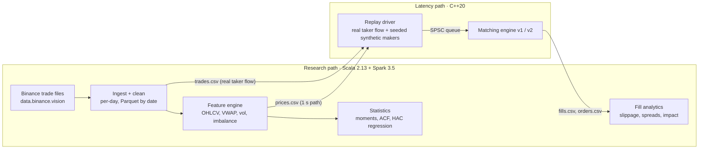

# TickScope

**A C++20 limit order book and matching engine that replays real Binance BTCUSDT order flow,
plus a Scala/Apache Spark pipeline for market-data research.** The engine runs the
latency-critical path: price-time priority matching, O(1) cancels, a cache-friendly v2 at
**52M events/s (1.76× v1, 2.20× on a deep book)** and a lock-free SPSC queue. The Spark side
runs the research path: it cleans 84.7M real trades, builds bars and statistics, and analyzes
the engine's fills, with a partition-pruned Parquet layout **≥31× faster than naive CSV**.
Every number in this README comes from a recorded run in [`docs/bench.md`](docs/bench.md) or
[`reports/stats.md`](reports/stats.md).

## Architecture



**Replay model.** Each real Binance trade becomes the aggressive order: `isBuyerMaker` gives
the taker side, so the trade replays as a market order (20%) or as an IOC order limited to
the real price ± 0.50 USDT (80%). The resting book is **synthetic**: seeded makers quote
around the previous second's real price and cancel at random. Fill analytics therefore
describe a simulated book absorbing real flow. They are not Binance's actual execution quality.

## Results

Machine: Apple M2 (4P + 4E cores, 128-byte cache lines), 8 GB RAM, Apple clang 21 `-O3`,
Spark 3.5.5 local mode. Laptop, not an isolated server: see the method notes in `docs/bench.md`.

### Matching engine: v1 (`std::map` + `std::list`) vs v2 (flat array + pool)

Same seeded stream for both engines. Before timing, both replay it and hash every fill:
**the fill streams are identical** (6,406,577 fills shallow, 11,230,290 deep).

| Scenario (real 2026-11-05 flow) | Book depth (avg levels) | v1 events/s | v2 events/s | Speedup |
|---|---|---|---|---|
| Default (13.6M events) | 91 | 29.5M | **52.0M** | **1.76×** |
| Deep book (22.1M events) | 2,215 | 22.4M | **49.4M** | **2.20×** |

| p99 latency (ns) | v1 | v2 | | Microbenchmark | v1 | v2 |
|---|---|---|---|---|---|---|
| rest a limit order | 125 | 42 | | add + cancel, 1,000 levels | 84.7 ns | 19.0 ns |
| order that trades | 417 | 167 | | add + fill | 84.2 ns | 27.5 ns |
| market order | 375 | 167 | | | | |
| cancel | 125 | 42 | | | | |

p50 is below the 41 ns resolution of Apple Silicon's `steady_clock`, so it is reported as
"<41 ns" rather than as a number.

### Two-thread pipeline: SPSC lock-free queue (engine v2)

| Mode | Events/s |
|---|---|
| Single thread | 53.1M |
| SPSC queue, batch pop 64 | 50.7M (95% of single thread) |
| SPSC queue, pop 1 | 36.9M |
| Mutex-protected queue | 6.9M |

The lock-free queue is 5.4–7.4× faster than the mutex baseline. The pipeline does not beat
one thread here because the producer does no real work. The benchmark isolates the cost of
the queue.

### Spark: same workload, five storage/execution variants

Q1 (1-minute bars) + Q2 (daily summary) over 7 of 30 days (22.5M of 84.7M trades), 3 runs each:

| Variant | Median | vs CSV | Files read |
|---|---|---|---|
| gzip CSV, re-parsed per query | 81.38 s | 1× | 30 |
| Parquet, timestamp filter | 2.51 s | 32× | 30 |
| **Parquet + partition pruning on `date`** | **1.56 s** | **52×** | **7** |
| + cache | 6.01 s | 13.5× | 7 |
| + 8 shuffle partitions | 6.15 s | 13.2× | 7 |

The CSV baseline is noisy between sessions (47.8–81.4 s), so the conservative figure is
**≥31× / ≥96.8% less runtime**. Caching *hurt*: building the cache cost ~4 s for two
queries. Manual shuffle tuning did nothing, because Spark's adaptive execution had already
coalesced the shuffle to 1 partition.

### What the data says (2026-10-30 → 2026-11-05, 10,079 one-minute returns)

- **Fat tails:** excess kurtosis **11.47**; **82** moves beyond 4σ where a normal
  distribution predicts ~0.6.
- **Volatility clustering:** return autocorrelation lags 1–5 is ≈ 0, but |return|
  autocorrelation is 0.31–0.36 at every lag.
- **Order-flow imbalance → next-minute return:** r = 0.021, Newey-West HAC t = **2.47**
  (naive t = 2.09). Significant at 5%, but it explains 0.04% of variance (0.24 bp per unit of
  imbalance), far below trading costs.
- **Simulated execution:** market orders filled 53.4% of quantity (86.3% fully filled).
  Synthetic makers quoting around the previous second's price show negative effective
  spread and positive price impact: they were picked off when the price moved (adverse selection).

Full tables: [`reports/stats.md`](reports/stats.md).

## Design decisions

| Decision | Why |
|---|---|
| Prices in int64 ticks, quantities in int64 lots | Exact matching: no 1e-17 BTC remainders, no "equal" prices comparing unequal |
| v1: `std::map` levels + `std::list` FIFO + `unordered_map<id, iterator>` | Clear baseline. O(log L) level access, O(1) cancel; list iterators survive other inserts and erases |
| v2: flat level array over a 65,536-tick band + two-level bitmap | Level access is one index computation; the best price is found with `countl_zero` |
| v2: out-of-band fallback map + recentering | BTC moved ~440k ticks in one day, so no fixed array covers it |
| v2: order pool + free list + intrusive list + open-addressing id map | No allocation per order, 32-bit indices, contiguous memory |
| Hand-written RNG distributions | `std::*_distribution` differs between libc++ and libstdc++; seeded streams must match everywhere |
| SPSC: acquire/release only, cached indices, `alignas(128)` | Minimum ordering for correctness; Apple M-series cache lines are 128 bytes |
| Spark: explicit schema, decimals for price/qty | Exact tick and lot conversion; no schema-inference pass |
| Spark: per-day incremental ingestion | One 30-day job filled the disk with spill; per-day batches bound memory and disk use |
| Spark: aggregations and windows on bars, never `collect()` on trades | Partial aggregation shrinks 22.5M rows to ~10k before the shuffle |

The full reasoning for each phase, plus likely interview questions, is in [`docs/notes.md`](docs/notes.md).

## How it is tested

- **Engine (69 tests, ASan + UBSan in CI):** the order book tests run against both v1 and
  v2. **Differential tests** compare both books with a naive reference book on 20k-op random
  streams, including a tiny-band drifting-price mode that forces 100+ recenters.
- **Concurrency:** 10M-item SPSC stress tests and a lockstep handoff test, run under
  **ThreadSanitizer** in CI.
- **Mutation testing** found two gaps, each now covered by a test: a v2 recentering path
  the random streams never reached, and a "publish before write" bug in the queue that the
  streaming stress tests and TSan missed. Weakening a single `release`/`acquire` was *not*
  caught by tests or TSan. That limit is documented: it needs a model checker.
- **Analytics (29 ScalaTest tests):** exact drop counts per reason on a fixture with planted
  bad rows; known-answer OHLCV/VWAP/imbalance on a hand-computed tape; statistics checked
  against plain-array implementations; slippage and spreads on hand-computed fixtures.
- **Cross-checks on real data:** Spark's fill rates equal the C++ engine's counters; every
  trade lands in exactly one bar; VWAP is inside [low, high] for every bar.

## Quickstart

Requirements: CMake ≥ 3.24, Ninja, a C++20 compiler, Java 17, sbt. About 1.5 GB of disk for
7 days of data.

```bash
# 1. Data: 7 days of BTCUSDT trades (checksummed, stored gzip)
scripts/download.sh 7

# 2. Spark: tests, clean -> Parquet, features, stats
cd analytics
sbt test
sbt "runMain tickscope.ingest.IngestJob --raw ../data/raw --out ../data/clean"
sbt "runMain tickscope.features.FeatureJob --clean ../data/clean --out ../data/features --prices ../data/prices.csv"
sbt "runMain tickscope.ingest.ExportTrades --clean ../data/clean --out ../data/trades.csv --from 2026-11-05 --to 2026-11-05"
sbt "runMain tickscope.stats.StatsJob --bars ../data/features/bars_1m --report ../reports/stats.md"
cd ..

# 3. Engine: tests with sanitizers, then benchmarks
cmake -S engine -B build -G Ninja -DCMAKE_BUILD_TYPE=Debug -DTICKSCOPE_SANITIZE=ON
cmake --build build && ctest --test-dir build
cmake -S engine -B build-rel -G Ninja -DCMAKE_BUILD_TYPE=Release && cmake --build build-rel
./build-rel/tickscope_replay --engine both --reps 5 --fills data/fills.csv --orders data/orders.csv
./build-rel/bench/tickscope_bench --benchmark_repetitions=5

# 4. Fill analytics (appends section 5 to reports/stats.md)
cd analytics && sbt "runMain tickscope.fills.FillJob --fills ../data/fills.csv --orders ../data/orders.csv --bars ../data/features/bars_1m --prices ../data/prices.csv --clean ../data/clean --day 2026-11-05 --report ../reports/stats.md"
```

## Layout

| Path | What |
|---|---|
| `engine/include/tickscope/` | `order_book.hpp` (v1), `order_book_v2.hpp`, `flat_structures.hpp`, `spsc_queue.hpp`, `generator.hpp`, `replay.hpp`, `rng.hpp` |
| `engine/src/` | Book implementations, CSV parsing, generator, `tickscope_replay` driver |
| `engine/tests/`, `engine/bench/` | GoogleTest suites (incl. reference book), Google Benchmark suites |
| `analytics/src/main/scala/tickscope/` | `ingest/`, `features/`, `stats/`, `fills/`, `bench/` |
| `scripts/download.sh` | Checksummed data download |
| `docs/` | `bench.md` (every run), `notes.md` (design + interview notes), `spark-plans.md`, `PLAN.md` |
| `reports/stats.md`, `results/*.json` | Generated reports and machine-readable results |

## Limitations

- **Synthetic resting book:** real taker flow, simulated makers. No L2/L3 quote data is
  used, so spreads use a last-trade price path as the reference.
- **Single instrument**, no FOK/stop/iceberg orders, no self-trade prevention, no
  network or protocol layer.
- **Laptop timings:** no core isolation (macOS does not allow pinning), 41 ns timer
  resolution, thermal variance (visible in the Spark CSV baseline).
- **v2 memory:** 1.5 MB of levels per side regardless of use; fine for one instrument,
  but a multi-instrument engine would need per-instrument sizing.
- **Spark scale:** 30 days on one laptop. The code uses the SparkSession builder and Hadoop
  FileSystem APIs, so it runs unchanged on a cluster, but no cluster run is reported here.

## License

MIT
