# TickScope — Build Plan

> **Status (2026-11-07):** Phases 0–9 done (see `docs/bench.md`, `docs/notes.md`). Remaining: Phase 10 dashboard; optional EMR run. Spark data: 30 days (disk-limited) instead of 1–3 months.

A C++20 limit order book and matching engine for the latency path, a Scala/Spark
pipeline for market-data research, and a static dashboard that shows the results.
Data: Binance BTCUSDT spot trades (data.binance.vision).

## Architecture

```mermaid
flowchart LR
  subgraph Research["Research path · Scala 2.13 + Spark 3.5"]
    A[Binance trade CSVs] --> B[Ingest + clean<br/>Dataset&#91;Trade&#93; → Parquet by date]
    B --> C[Feature engine<br/>OHLCV, VWAP, vol, imbalance]
    C --> D[Analytics<br/>stats, slippage, spread]
  end
  subgraph Latency["Latency path · C++20"]
    E[Replay driver<br/>real taker flow + synthetic resting book] --> F[Matching engine<br/>order book, fills]
  end
  B -- "trades.csv (taker flow)" --> E
  C -- "prices.csv (1s mid path)" --> E
  F -- "fills.csv" --> D
  D -- "JSON results" --> G[Dashboard<br/>GitHub Pages]
  F -- "bench JSON" --> G
```

**Replay model.** Incoming (aggressive) orders are the *real* Binance trades: the
`isBuyerMaker` flag gives the aggressor side, so each trade becomes a market/IOC order of
the real size at the real time. The resting book is synthetic: a seeded generator posts and
cancels limit orders around the real 1-second price path. Fill analytics therefore measure
how a simulated book absorbs real order flow, and the README says so.

## Conventions
- Prices: int64 ticks of 0.01 USDT. Quantities: int64 lots of 1e-5 BTC. Never double.
- Timestamps: int64 microseconds. Binance spot files moved from milliseconds to microseconds
  in 2025; ingestion detects the unit per file and normalizes.
- Machine: Apple M2, 8 GB RAM. Spark driver capped at 4 GB; start with 7 days of data.

## Phases

Order of work: 0 → 1 → 4 → 5 → 2 → 3 → 6 → 7 → 9 → 10 → 8. The engine comes early
because it is the centerpiece; it is tested on a synthetic random-walk path until Spark
produces real `prices.csv` / `trades.csv`.

### Phase 0 — Bootstrap and CI
- CMake (C++20, Ninja, FetchContent GoogleTest + Google Benchmark), sbt (Scala 2.13,
  spark-sql 3.5, ScalaTest), placeholder tests.
- Spark on Java 17: forked JVM with `--add-opens` flags.
- CI (`.github/workflows/tickscope-ci.yml`, path-filtered to `TickScope/**`):
  engine Debug + ASan/UBSan + ctest; Release build to check the bench binary compiles;
  analytics Java 17 + `sbt test`. Dependency caches for both.

Done when: ctest and sbt test pass locally; CI green.

### Phase 1 — Download, ingest, clean
- `scripts/download.sh N`: fetch N days of BTCUSDT spot trade zips, verify `.CHECKSUM`
  (SHA-256), unzip into `data/raw/`.
- `Trade(tradeId, price, qty, quoteQty, ts, isBuyerMaker)`; explicit schema, no header row.
- Timestamp unit detection (ms vs µs) and normalization to µs.
- Drop duplicate `tradeId`; reject non-positive price/qty; reject a timestamp that goes
  *backwards* versus the previous `tradeId` within the day (equal timestamps are normal).
  Per-day window ordered by `tradeId` with `lag`, no global sort.
- Log rows read / dropped per reason; write Parquet partitioned by `date`.
- Export `data/trades.csv` (ts, side, priceTicks, qtyLots) for the replay driver.

Done when: 7 days cleaned with drop counts logged; fixture test asserts exact drops per
reason, including a µs-timestamp fixture.

### Phase 2 — Feature engine
- Per 1m and 5m bar: OHLCV, VWAP, trade count, log return, rolling realized volatility
  (window param), buy/sell volume, imbalance = (buy − sell) / (buy + sell).
- Export the 1-second last-price series to `data/prices.csv`.

Done when: known-answer tests for OHLCV, VWAP and imbalance pass; notes explain which
steps shuffle and why.

### Phase 3 — Statistics report → `reports/stats.md`
- Mean, std, skew, excess kurtosis of 1m log returns; autocorrelation lags 1–5.
- Correlation of imbalance(t) with return(t+1): n, Pearson r, naive t-stat **and** a
  Newey-West (HAC) t-stat, with a note on why the naive one overstates significance.
- Spark aggregates and `lag` windows only; no `collect()` of the full dataset.

### Phase 4 — Order book v1
- `Order{id, side, priceTicks, qtyLots, ts}`; bids `std::map` (descending), asks
  `std::map` (ascending); each level a `std::list<Order>` FIFO;
  `unordered_map<id, iterator>` for O(1) cancel.
- Operations: `addLimit`, `addMarket`, `addIoc`, `cancel`, `amend`, `bestBid`, `bestAsk`.
  - `amend`: reducing quantity keeps queue priority; changing price is cancel + re-add and
    loses priority.
  - Market/IOC remainder after liquidity runs out is discarded and reported, never rested.
- Price-time priority, partial fills, multi-level sweeps; emit
  `Fill{ts, makerId, takerId, takerSide, priceTicks, qtyLots}`.
- Tests: partial fill, 3-level sweep, cancel after partial, FIFO within a level, market on
  empty side, amend-down keeps priority, amend-price loses priority, IOC remainder.
- Limitations (documented): no FOK, no self-trade prevention, single instrument.

Done when: all tests pass under ASan/UBSan; notes give the Big-O of every operation.

### Phase 5 — Replay driver, fills, benchmark v1
- Replay driver: real taker flow from `trades.csv` + seeded synthetic resting liquidity
  around `prices.csv` (configurable add/cancel mix, size and offset distributions).
- Writes `data/fills.csv` (with order type of the taker).
- Benchmarks (Release, ≥1M ops, warm-up, 5 repetitions, median):
  - Throughput: orders processed / wall time.
  - Latency: timed in batches (or with timer overhead measured and subtracted), recorded
    into a log-bucketed histogram → p50 / p99 / p99.9. Never mean alone.
  - Record machine, flags, data size and raw output in `docs/bench.md`, plus JSON for the
    dashboard. Note laptop limits: thermal throttling, no core pinning on macOS.

### Phase 6 — Optimization v2
- Flat array of price levels over a bounded band around the current price
  (BTC ≈ 10M ticks wide, so the band is essential).
  - Out-of-band orders go to a fallback `std::map`; the band recenters when the price
    drifts near its edge.
  - Finding the next best level: a bitmap of occupied levels (word scan with
    count-trailing-zeros) instead of a linear scan.
- Preallocated order pool with a free list; intrusive doubly linked list per level.
- Differential test: v1 and v2 produce **identical fill streams** on the same seeded input.
- Benchmark v1 vs v2 on identical input; explain the speedup (allocations, pointer chasing,
  cache locality).

### Phase 7 — Fill analytics
- Fill rate per order type, market-order slippage vs 1m VWAP, realized spread, fill-size
  distribution; join fills to bars on time; append to `reports/stats.md`.
- Clearly labelled: simulated resting book against real taker flow.
- Test: slippage on a small hand-computed joined fixture.

### Phase 8 — SPSC ring buffer (stretch)
- Power-of-two capacity, atomic head/tail with acquire/release, cache-line padding,
  cached opposite index to cut cross-core traffic.
- Stress test: 10M items, order preserved, repeatedly, under TSan.
- Benchmarks: single-thread vs two-thread pipeline, single vs batched pop, and a
  mutex-queue baseline.

### Phase 9 — Spark benchmark and README
- Same 1–3 months of data for every variant: CSV defaults → Parquet → + partition pruning
  (date filter) → + caching → + tuned `spark.sql.shuffle.partitions`. 3 runs each, median.
- Include `explain()` plans showing the shuffles and the pruned partitions.
- README: pitch, Mermaid architecture, quickstart, benchmark tables, stats findings, design
  decisions, limitations (synthetic resting book, single instrument, laptop timings, no
  network/protocol layer). Real numbers only.

### Phase 10 — Results dashboard
- Static site (Vite + React + charts) in `dashboard/`, reading JSON written by the engine
  and Spark jobs; deployed to GitHub Pages by CI.
- Sections: market data (candles + VWAP, volatility, buy/sell volume); statistics (return
  histogram vs normal, ACF, imbalance scatter); engine (v1 vs v2 throughput, latency
  histograms, SPSC pipeline); Spark (runtime per optimization step); fill analytics; an
  order-book replay showing the depth ladder and fills over a real time window.
- Optional: compile the engine to WebAssembly so the replay runs the real matcher in-browser.

### Optional — AWS EMR run
Run Phases 1–3 once on a small EMR cluster reading from S3; record runtime and cost;
terminate immediately. Only then list EMR as a skill.

## Testing and CI
| Area | Framework | Covers |
|---|---|---|
| Order book | GoogleTest | Partial fills, sweeps, FIFO, cancel after partial, empty-side market, amend, IOC |
| v1 vs v2 | GoogleTest | Identical fill streams on seeded input |
| Memory safety | ASan + UBSan (CI) | All engine tests |
| Concurrency | TSan + stress | SPSC: 10M items, order preserved |
| Ingestion | ScalaTest | Exact drops per reason; ms/µs timestamps |
| Features | ScalaTest | Known-answer OHLCV, VWAP, imbalance |
| Fill analytics | ScalaTest | Slippage vs VWAP |

Benchmarks run locally only; CI checks the benchmark binary builds.

## Timeline (realistic: 60–80 hours)
1. Weekend 1: Phases 0, 1, 4.
2. Weekend 2: Phases 5, 2, 3.
3. Weekend 3: Phases 6, 7.
4. Weekend 4: Phases 9, 10 — resume-ready.
5. Later: Phase 8, optional EMR.

## Resume entry (fill brackets only from `docs/bench.md` / `reports/stats.md`)
**TickScope – Order Book Engine & Market-Data Analytics**
- Built a C++20 limit order book and matching engine (price-time priority, O(1) cancels)
  replaying real Binance trade flow at [X]M orders/sec and [X] µs p99; a flat-array and
  memory-pool redesign improved throughput [X]× over a `std::map` baseline.
- Built a Scala/Apache Spark pipeline over [X]M+ trades computing OHLCV, VWAP, realized
  volatility, slippage and order-flow statistics into partitioned Parquet, cutting runtime
  [X]% via partition pruning and shuffle tuning; GoogleTest/ScalaTest in GitHub Actions CI.

List concurrency/SPSC and AWS EMR only after Phase 8 and the EMR run exist.
